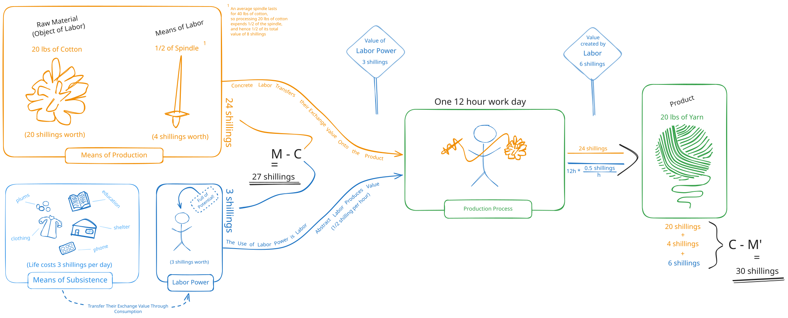

## Player
<iframe data-testid="embed-iframe" style="border-radius:12px" src="https://open.spotify.com/embed/episode/0JPxKXXiEIYwK2emT71sLp" width="100%" height="152" frameBorder="0" allowfullscreen="" allow="autoplay; clipboard-write; encrypted-media; fullscreen; picture-in-picture" loading="lazy"></iframe>



## Visualizations
Here's a Visualizations of the Valorization process: Next time, we'll update/annotate it!

