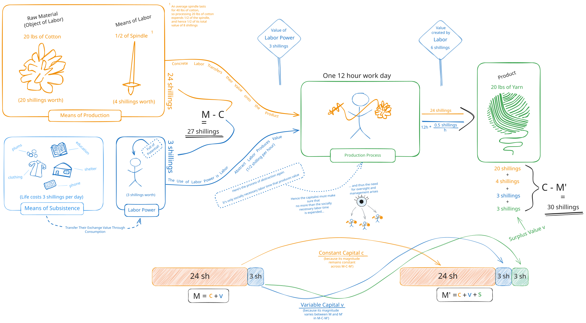

## Player
<iframe data-testid="embed-iframe" style="border-radius:12px" src="https://open.spotify.com/embed/episode/4mr8xrp4UjMxT0hYP8uNsD" width="100%" height="152" frameBorder="0" allowfullscreen="" allow="autoplay; clipboard-write; encrypted-media; fullscreen; picture-in-picture" loading="lazy"></iframe>



## Visualizations
And here's the promised update to the illustration of the valorization process - now with constant and variable capital

